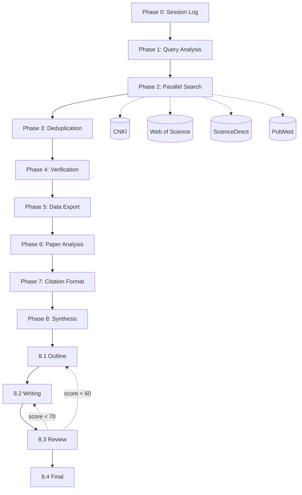

# Literature Reviewer Skill

> [中文（主文档）](./README.md) | **English (reference translation)**

> The Chinese README is the canonical project documentation. This English version is a companion translation; when the two differ, follow the Chinese README and the repository's configuration files.

<p align="center">
  
  
  
  
  
</p>

> ⚠️ **Security notice:** This Skill relies on a browser Skill for browser automation and can access browser cookies and signed-in sessions. Use an isolated environment such as Docker where possible. Read [SECURITY.md](./SECURITY.md) before use.

<p align="center">
  <b>A systematic literature-review Skill for Kimi CLI</b>
</p>

<p align="center">
  An eight-phase workflow using browser-automated search across CNKI, Web of Science, ScienceDirect, and PubMed, with GB/T 7714-2015-formatted literature-review output.
</p>

---

## Overview

**Literature Reviewer Skill** is a Skill plug-in for systematic Chinese- and English-language literature reviews. It converts a research topic into a search strategy, collects and organizes results, then produces structured review materials.

### Highlights

- 🚀 **Eight-phase workflow:** From query analysis through review synthesis.
- 🌐 **Browser automation:** Searches academic databases without API configuration.
- ✅ **Multiple databases:** CNKI, Web of Science, ScienceDirect, PubMed, and Google Scholar.
- 📚 **Structured output:** Markdown literature records with titles, abstracts, and GB/T 7714-2015 citations.
- 🔄 **Resumable sessions:** Saves session progress for later continuation.

---

## Features

| Module | Description | Status |
| --- | --- | --- |
| 🔍 Query analysis | AI-generated Chinese and English keywords and search strategies | ✅ Available |
| 🌏 Chinese literature search | CNKI browser automation | ✅ Available |
| 🌍 English literature search | Web of Science, ScienceDirect, and PubMed | ✅ Available |
| 🔄 Deduplication | Title-similarity matching | ✅ Available |
| ✅ Metadata verification | Basic completeness checks | ✅ Available |
| 📄 Data export | Markdown with abstracts | ✅ Available |
| 📖 Paper analysis | In-depth analysis of each paper | ✅ Available |
| 📝 Citation formatting | GB/T 7714-2015 | ✅ Available |
| 📝 Review synthesis | Outline, writing, review, and polishing loop | ✅ Available |

---

## Eight-phase workflow



| Phase | Name | Primary task | Output |
| --- | --- | --- | --- |
| 0 | Session Log | Create a session directory and record progress | `session_log.md` |
| 1 | Query Analysis | Generate bilingual keywords and strategies | `keywords.json`, `queries.json` |
| 2 | Parallel Search | Search databases through the browser | `papers_raw.json` |
| 3 | Deduplication | Remove duplicates and filter records | `papers_deduplicated.json` |
| 4 | Verification | Check metadata completeness | Verified literature list |
| 5 | Data Export | Export literature data to Markdown | `references.md` |
| 6 | Paper Analysis | Analyze individual papers | `papers_analysis.md` |
| 7 | Citation Format | Format GB/T 7714-2015 citations | Formatted citation list |
| 8 | Synthesis | Produce the literature review | See sub-phases below |

### Phase 8 sub-phases

| Sub-phase | Name | Primary task | Output |
| --- | --- | --- | --- |
| 8.1 | **Outline** | Cluster themes and construct a review structure | `outline.md` |
| 8.2 | **Writing** | Write a 3,000–5,000-word draft | `draft.md` |
| 8.3 | **Review** | Assess quality across six weighted dimensions | `review_report.md` |
| 8.4 | **Final** | Revise, polish, and generate abstract and keywords | `literature_review.md` |

The Phase 8 review loop works as follows:

- **Score ≥85:** Make minor revisions and finalize.
- **Score 70–85:** Return to writing and rewrite selected sections.
- **Score 60–70:** Return to outlining and restructure the review.
- **Score <60:** Check literature quality and, if necessary, search again.

---

## Quick start

### Installation

#### Option 1: Install through natural language (recommended)

The Skill is designed to work with Skills/MCP systems in AI coding tools including Kimi CLI, KimiClaw, MaxClaw, Claude Code, OpenCode, TRAE, and VS Code. Ask your supported AI tool to clone this repository into its Skills directory as `literature-reviewer-skill`.

#### Option 2: Manual installation

1. Locate your tool's Skills directory:

   - Kimi CLI / KimiClaw: `~/.kimi/skills/`
   - MaxClaw: `~/.maxclaw/skills/`
   - Claude Code: `~/.claude-code/skills/`
   - OpenCode: `~/.opencode/skills/`
   - TRAE: `~/.trae/skills/`
   - VS Code: `.vscode/skills/`

2. Clone the repository into that directory:

```bash
cd ~/.kimi/skills  # Or the equivalent directory for your tool
git clone https://github.com/stephenlzc/AI-Powered-Literature-Review-Skills.git literature-reviewer-skill
```

3. Restart the AI tool if necessary.

#### Option 3: Docker installation (recommended for isolation)

```bash
git clone https://github.com/stephenlzc/AI-Powered-Literature-Review-Skills.git
cd AI-Powered-Literature-Review-Skills
docker-compose up -d
docker-compose ps
```

Docker provides a separate browser environment, resource limits, and a restricted filesystem. The repository mounts `./sessions` and `./output` as writable locations; other Skill files are intended to be read-only. Configure your AI tool to use the Skill path inside the container.

#### Option 4: Review before installation

Review the repository in an isolated directory before copying it to a production Skills directory:

```bash
mkdir -p ~/test-skills
cd ~/test-skills
git clone --depth 1 https://github.com/stephenlzc/AI-Powered-Literature-Review-Skills.git
cat AI-Powered-Literature-Review-Skills/SKILL.md
cat AI-Powered-Literature-Review-Skills/SECURITY.md
cat AI-Powered-Literature-Review-Skills/scripts/*.py
```

### Dependency check

The `browser` Skill is required. Check that it and Playwright are available:

```bash
ls ~/.kimi/skills/browser  # Or the corresponding path for your tool
playwright --version
playwright install chromium
```

### Usage examples

Use a natural-language request in a compatible AI tool, for example:

```text
Create a literature review on deep learning for medical image diagnosis.
```

```text
Find literature on Transformer models in natural-language processing, with 20 Chinese and 20 English papers.
```

```text
Write a literature review on artificial intelligence in early cancer screening.
Requirements:
- 20 Chinese papers and 20 English papers
- Last five years
- Include an abstract, keywords, main text, and references
- Use GB/T 7714-2015 citations
```

---

## Project structure

```text
literature-reviewer-skill/
├── SKILL.md                 # Required Skill entry point
├── README.md                # Chinese canonical README
├── README_EN.md             # English reference translation
├── AGENTS.md                # Project architecture notes
├── SECURITY.md              # Security declaration and disclaimer
├── mcp.json                 # MCP configuration and dependency declaration
├── install.yaml             # Installation configuration
├── Dockerfile               # Docker image definition
├── docker-compose.yml       # Docker Compose configuration
├── agents/                  # Agent templates
├── references/              # Research and database guidance
├── scripts/                 # Helper scripts
├── examples/                # Examples; not included in Skill installation
└── sessions/                # Runtime-generated session data
```

---

## Dependencies and permissions

| Dependency | Version | Purpose | Status |
| --- | --- | --- | --- |
| `browser` Skill | >=1.0.0 | Browser automation through Playwright | ⚠️ Required |
| `web_search` Skill | >=1.0.0 | Supplemental web search | Optional |
| `docx` Skill | >=1.0.0 | Word-document generation | Optional |

The repository includes `mcp.json` and `install.yaml` to declare dependencies, permissions, allowed domains, and resource limits. The runtime permissions are summarized below:

```yaml
filesystem:
  read: ./agents/, ./references/, ./scripts/, ./examples/
  write: ./sessions/, ./output/

network:
  allowed:
    - kns.cnki.net
    - www.webofscience.com
    - www.sciencedirect.com
    - scholar.google.com
    - pubmed.ncbi.nlm.nih.gov

browser:
  allowed_operations: navigate, click, fill, evaluate, screenshot, download
  restricted: file://, localhost, 127.0.0.1
```

---

## Supported databases

| Database | Type | Access method |
| --- | --- | --- |
| CNKI | Full text | Browser automation |
| Web of Science | Citation index | Browser automation |
| ScienceDirect | Full text | Browser automation |
| PubMed | Biomedical | Browser automation |
| Google Scholar | Academic search | Web search |

No database API configuration is required; the Skill accesses each database's search interface through the browser.

---

## Output

The Skill can generate the following files in the session output directory:

| File | Contents |
| --- | --- |
| `references.md` | Literature records with titles, authors, publication details, DOI, abstracts, and source databases |
| `papers_analysis.md` | Per-paper analysis covering findings, limitations, controversies, gaps, and citation information |
| `gb7714_citations.txt` | GB/T 7714-2015-formatted citations |
| `literature_review.md` | Structured review with title, abstract, keywords, introduction, methods, Chinese and international research status, discussion, conclusion, and references |

---

## Security and responsible use

**Read [SECURITY.md](./SECURITY.md) before use.** Key risks and safeguards include:

| Risk | What it means | Recommended safeguard |
| --- | --- | --- |
| Browser automation | The Skill can access cookies and signed-in browser sessions | Use a private window or dedicated browser profile |
| Network access | It connects to multiple academic databases | Follow each service's terms and control request frequency |
| Local writes | It writes to `sessions` and `output` | Restrict write permissions and clean data periodically |
| Anti-bot controls | Large searches can trigger CAPTCHAs | Be ready to complete CAPTCHAs manually |

Recommended practices:

1. Prefer Docker for isolation.
2. Do not run it in a browser profile signed in to sensitive accounts such as banking, email, or social media.
3. Review `SKILL.md`, `SECURITY.md`, scripts, and agent templates before installation.
4. Do not let an AI tool run installation commands without review.

This project is for academic research. Users are responsible for respecting database terms of service and copyright restrictions.

---

## Reference materials

- `references/cnki-guide.md` — CNKI advanced-search guide
- `references/database-access.md` — Access guidance for each database
- `references/gb-t-7714-2015.md` — GB/T 7714-2015 citation-format guide

## Version history

### v3.1.0 (2025-03-09)

- Added the complete security declaration in `SECURITY.md`.
- Added Docker support for isolated execution.
- Added `mcp.json` and `install.yaml` dependency declarations.
- Added compatibility notes for KimiClaw, MaxClaw, Claude Code, OpenCode, TRAE, and VS Code.
- Renamed the project from `literature-survey` to `literature-reviewer-skill`.
- Added three complete examples: AI education, carbon-neutrality policy, and Uniqlo social-media marketing.

### Earlier versions

- **v3.0.0 (2024-03):** Replaced API configuration with browser automation, simplified deduplication and verification, and adopted Markdown output.
- **v2.0.0 (2024-01):** Rebuilt the eight-phase workflow, added Agent Swarm architecture, and added citation verification.
- **v1.0.0 (2023):** Initial release.

## Acknowledgements

The project draws on ideas and designs from:

- [flonat/claude-research](https://github.com/flonat/claude-research)
- [openclaw/skills](https://github.com/openclaw/skills)
- [cookjohn/cnki-skills](https://github.com/cookjohn/cnki-skills)
- [diegosouzapw/awesome-omni-skill](https://github.com/diegosouzapw/awesome-omni-skill)

## ⭐ Star History

[](https://www.star-history.com/#stephenlzc/AI-Powered-Literature-Review-Skills&Date)

## License

MIT License. See [LICENSE](./LICENSE) for the complete license text.

---

<p align="center">
  Made with ❤️ for researchers
</p>
